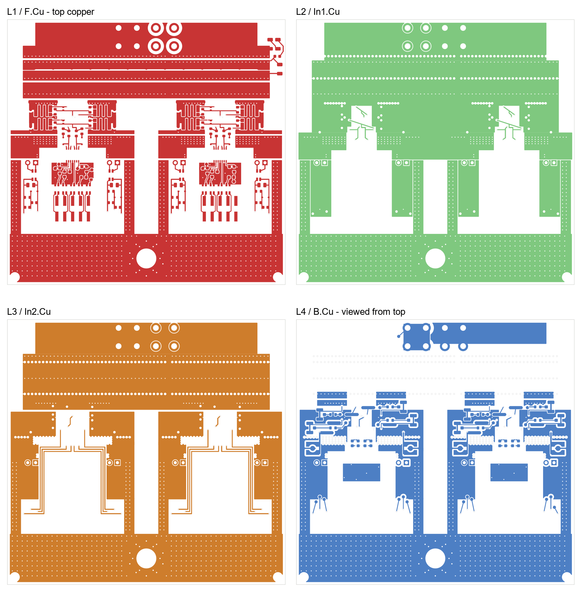

# Copper-layer and PWM-filter review

Date: 23 October 2026. Board: `hardware/spb-bb-revb-dpt`.

Reviewed PCB SHA-256: `1469E2D33AB9E166A42892016C0DA6C05E8560E1D037732862C992CD3387F336`.

This board differs from the revision recorded in `review.md`. These observations use fresh individual copper-layer exports and actual pad/net connections. The earlier DRC results must not be attributed to this new hash: DRC was not repeated in this layer-focused review. No design files were changed. No Q3D or switching simulation was run.

## Layer pictures

All views use the same top-view orientation, including the bottom layer. Copper colours identify layers, not nets. The pictures show saved filled copper, not simulated current density.

Full-resolution images: [L1 top](figures/layer-review-2026-10-23/F.Cu.png), [L2](figures/layer-review-2026-10-23/In1.Cu.png), [L3](figures/layer-review-2026-10-23/In2.Cu.png), [L4 bottom](figures/layer-review-2026-10-23/B.Cu.png).

## Layout observations for high-current, fast-switching GaN

### L1: compact power cells and short gate branches are favourable

The four power cells occupy a compact band immediately below the bypass-capacitor copper. Broad power connections reach the device lands, and the gate branches enter from the central driver corridors. The individual gate resistors remain close to the gates. This is a sensible arrangement for reducing commutation-loop area and separating gate drive from the main source current.

The geometric bottlenecks deserve more attention than the total copper area: device-pad exits, the source-to-shunt connection and the transition into the return via field. Wide copper elsewhere does not establish the current capacity or inductance of those transitions. Inspect their heating and per-cell current sharing during staged tests; the pictures alone cannot qualify the intended pulse current.

### L2: useful return copper, with perforated regions to preserve

L2 provides broad return copper beneath the upper power region. The gate/Kelvin routing occupies deliberate cut-outs in the driver corridors. This is better than letting control traces cut arbitrarily across the power return.

Long rows of opposite-net via clearances visibly perforate the plane. Some local clearance holes form scalloped slots. They are not proof of an open circuit or an unacceptable loop, but they can concentrate current into the remaining copper bridges or force lateral detours. Do not enlarge antipads or add further rows without checking the available return cross-section. Count nearby useful vias and inspect their connection to the capacitor return, rather than relying on total via count.

### L3: supply routing is separated, but the switch-node area is large

The isolated gate-supply routes travel around the control islands and leave their centres clear. Their length is less concerning than a long gate-current loop, provided the local driver capacitors supply the switching current.

The broad lower bus is **SW**, confirmed from board-zone nets on all four layers; it is not a quiet ground plane. Its lower rectangular zone spans approximately x = 106.05–193.95 mm, y = 144.5–160.0 mm. Side copper also carries the output towards this bus.

This area has a legitimate current-carrying function, but exposed SW area and nearby cables/metal create common-mode coupling. For illustration only, 10 pF to an external object at 50 V/ns carries 0.5 A of displacement current: `i = C × dv/dt`. Neither that capacitance nor current was extracted for this board.

Keep PWM cables and grounded metal away from the SW bus and its side columns. For a later revision, consider whether any unused SW extension can be reduced while preserving conductor cross-section and thermal performance. Do not indiscriminately remove the required output copper or add an earth-referenced shielding plane beneath it.

### L4: local decoupling is useful; measurement routes occupy sensitive space

Bottom-side driver decoupling is close to the output region. The gate/Kelvin pairing uses adjacent layers in portions of the route, making the specified outer dielectric spacing important.

The bottom layer also contains U.FL/MMCX structures and sense routes beside switching copper. Treat those routes as part of the measurement system: proximity to SW, pickup-loop area and probe capacitance can change the observed ringing. Keep unused gate-sense links DNP and start with the local spring pads. Do not tie distinct source/Kelvin references together through oscilloscope grounds.

### Control islands and filter keep-outs

The layer images show copper voids beneath the choke/header region and separated control islands. This limits direct capacitive bypass around the common-mode filters. Preserve these intentional voids. On the receiver side, retain the local GNDI return around the input RC networks; extending a void beneath the entire PWM route would make its return less controlled.

Overall, the images support the present compact-cell and paired-gate approach. The main layout sensitivities are current crowding around clearance rows, SW coupling into the external test setup, and the measurement paths. These are engineering concerns to validate, not confirmed shorts or quantified inductance failures.

## Will the PWM common-mode filters affect the PWM?

**Yes. They can improve immunity, but they are not transparent to pulse edges. Keep them provisionally and validate the complete cable/filter/driver chain before changing them.**

The saved board uses Würth **744232601** chokes: L3/L4 for block 1 PWM and L10/L11 for block 2. Each uses one winding for signal and one for its associated return. The receiver then has **47 Ω in series and 100 pF to GNDI**: R11/C17 and R12/C18 in block 1, with the repeated network in block 2.

### Desired behaviour and nonideal effects

With equal and opposite signal/return currents, an ideal common-mode choke presents little differential impedance while opposing common-mode current. The actual component has differential impedance, winding resistance and parasitic capacitance. Its manufacturer supplies separate common-mode and differential impedance curves. The nominal 600 Ω at 100 MHz is not a 600 Ω resistor in series with the desired PWM signal.

Fast PWM edges contain frequencies far above the PWM repetition rate. Leakage inductance and cable/input capacitance can slow an edge or cause ringing even when the repetition rate is modest. A choke's common-mode inductance must not simply be used as a standalone series inductance to predict differential pulse delay.

### Shared returns make this a multi-path circuit

All receiver-side return windings connect to GNDI. If their cable-side returns also join at the controller, they form parallel return paths. PWM transient current can divide through other signal-return windings and the supply return. Equal-and-opposite current in each individual choke is therefore not guaranteed. Actual current division depends on coupling and the complete interconnect.

This does not prove that the circuit fails, but it means each two-wire filter cannot be assessed in isolation. Additional bench-ground connections can also bypass a return winding. Check the actual cable and grounding arrangement used for DPT. For a future redesign with difficult cable conditions, differential signalling with a local receiver is worth evaluating; choose any choke and termination for that interface rather than copying this network unchanged.

### What the 47 Ω / 100 pF network implies

For an ideal first-order RC alone:

- Time constant: `47 Ω × 100 pF = 4.7 ns`.
- −3 dB frequency: approximately **33.9 MHz**.
- 10–90% rise time: approximately **10.3 ns**.

These are calculations, not measurements. Controller output impedance, cable effects, choke impedance, driver capacitance and probe loading are excluded. A 50 Ω generator source, for example, contributes additional series resistance and changes the result.

This network filters spikes but can shift threshold-crossing time and distort short pulses. Equal delay on both edges mostly shifts a pulse; unequal rising/falling delays change its width. Differences between channels alter effective dead time and sharing between drivers.

The driver datasheet gives a typical 18 ns minimum input pulse that changes output state; this is not a guaranteed robust operating pulse width. Do not design the complete filtered input chain at that typical limit.

### Recommended measurements

1. Use the intended controller, cable length, logic amplitude and grounding. Measure at the connector and at INA/INB relative to local GNDI, using low-capacitance probing that does not create an extra ground path.
2. Test the shortest planned high and low pulses, not only the nominal switching frequency. Check monotonic threshold crossings, pulse width and ringing.
3. Compare both channels of each driver and the corresponding inputs of U1 and U2. Measure actual gate timing as well as input timing.
4. Repeat during staged power switching: a clean signal with the power stage idle does not establish common-mode immunity.
5. If distortion is significant, investigate the source impedance and shared returns first. Then evaluate a lower-differential-impedance choke or a smaller input capacitor against the required noise rejection. A controlled bypass comparison requires bypassing both windings correctly and should start at low energy; do not remove filtering blindly.

The exact acceptability remains dependent on the controller's output impedance and logic amplitude, cable construction/length, shortest pulse width and required dead time. Those were not established in this review.

## Sources

- Local guidance: `Application Notes/Optimizing PCB Layout with eGaN FETs.pdf`, particularly its discussion of opposing-current loops and separation of gate and power current paths.
- [Würth 744232601 datasheet — winding diagram and impedance curves](https://www.we-online.com/components/products/datasheet/744232601.pdf).
- [Infineon 2EDF7275K datasheet — input characteristics and pulse timing](https://www.infineon.com/assets/row/public/documents/24/49/infineon-2edf7275k-datasheet-en.pdf).

## Disposition (2026-10-23)

- **PWM common-mode chokes removed** (L3/L4 and L10/L11 of the reviewed revision): the 2EDF7275K input side is
  isolated from both power domains, so on the bench DPT setup the chokes add little common-mode rejection, while
  their leakage inductance with the 100 pF input capacitor can ring and their delay can differ between the two
  drivers. The PWM pair now runs straight from the header to the 47 Ω / 100 pF filter; the header return pins go to
  GNDI directly. DIS, 12 V and NTC keep their chokes. The validation measurements of the review (connector and INA/INB,
  shortest pulses, U1 vs U2, during power switching) are in `DPT_measurement_setup.md`.
- **Layer observations:** no copper change. SW-bus cable routing, L2 return checks and measurement-route handling are
  in the DPT setup notes. The SW-area reduction is noted for the next revision.
